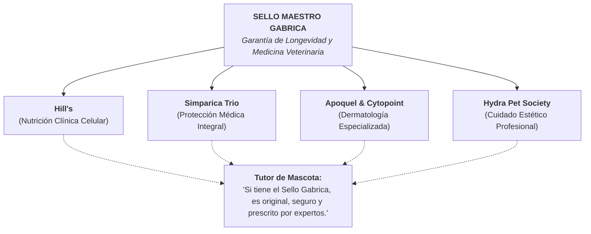

# Tesis Estratégica: Cómo transformar a Gabrica en una Masterbrand
**Autor:** Cristian Silva  
**Área:** Estrategia e Inteligencia de Datos  
**Fecha:** Octubre 2026  
**Proyecto:** Gabrica Masterbrand Intelligence  

---

## 1. La Verdad Oculta en los Datos: El "Gigante Invisible"

Tras procesar y cruzar más de **93,300 conversaciones y reseñas** de la categoría de mascotas en Colombia, junto con las 57 líneas de producto de nuestro catálogo y más de 15,000 quejas de la competencia, llegué a un diagnóstico tan claro como alarmante:

> **Gabrica es hoy un Gigante Invisible.**

Tenemos en nuestras manos las joyas de la corona de la medicina y nutrición veterinaria del país (Hill's Science Diet, Simparica Trio, Apoquel, Hydra, Seresto). Facturamos y dominamos los anaqueles de las clínicas veterinarias. Sin embargo, en la conversación digital del consumidor final, **la palabra "Gabrica" solo aparece 8 veces en 93,323 comentarios (un insignificante 0.008%)**, y nuestro índice de interés en Google Trends es de apenas **6.5 puntos**, mientras marcas masivas como Chunky (80.4) o Purina (74.6) acaparan la mente del consumidor.

### El Riesgo que no podemos ignorar
Hoy operamos como un operador logístico y distribuidor B2B silencioso. Si un tutor compra Hill's para tratar la insuficiencia renal de su perro o Simparica para protegerlo de garrapatas, su lealtad está con el laboratorio fabricante o con su veterinario de barrio, jamás con Gabrica. 

Si mañana una multinacional farmacéutica decide montar operación propia o cambiar de socio distribuidor, **nos quedaríamos sin nada**, porque no somos dueños del activo más valioso de este negocio: **el vínculo emocional y la confianza directa con el tutor de la mascota.**

---

## 2. El Error Fatal que NO Vamos a Cometer

Mi primera advertencia estratégica es tajante: **Gabrica jamás debe intentar convertirse en un Laika 2.0 ni en un Agrocampo 2.0.**

1. **Destrucción de Margen:** Entrar a competir en retail masivo de descuentos es una carrera hacia el fondo que destroza rentabilidad.
2. **Destrucción de Reputación:** En nuestra minería de datos identificamos más de **4,800 quejas directas hacia Laika** por retrasos en entregas, pedidos incompletos y pésimo servicio al cliente. La promesa de "conveniencia barata" es una trampa operativa.
3. **Traición a Nuestro Mayor Aliado:** Las más de 4,000 clínicas y médicos veterinarios de Colombia son el corazón de nuestro negocio. Si montamos un marketplace masivo para venderles directo a sus clientes por precio, los convertimos inmediatamente en enemigos comerciales.

---

## 3. Dónde está Nuestro Océano Azul: La Autoridad Médica y la Longevidad

Si analizamos el mapa competitivo de Colombia, nadie está ocupando el territorio más valioso de la categoría:

* **Laika** es dueña de la *conveniencia y el descuento rápido* (con alto desgaste de servicio).
* **Agrocampo** es dueño del *precio mayorista y el formato agro tradicional*.
* **Chunky y Purina** son dueños del *supermercado y el volumen económico*.

**Nadie es dueño de la Salud, la Tranquilidad y la Longevidad Animal.**

Gabrica no tiene que vender "comida para perros" ni "pastillas para pulgas". Nuestra verdadera propuesta de valor para el tutor de mascotas en Colombia debe ser una sola:

> **"Hacemos que tu perro o gato viva de 3 a 5 años más, sano, vital y a tu lado."**

No somos una tienda de mascotas. Somos el **Estándar de Medicina, Ciencia y Bienestar Animal de Colombia**.

---

## 4. La Estrategia: El Modelo *"Intel Inside"* (Endoso de Confianza)

Cuando una persona compra un computador Lenovo, Asus o Dell, busca con la mirada la calcomanía plateada que dice **"Intel Core"**, porque sabe que ese procesador es la garantía de que el equipo no va a fallar.

Ese es exactamente el modelo de arquitectura de marca que propongo para Gabrica: **Endorsed Masterbrand (Marca Avalada)**.

### Por qué esto resuelve los dolores de la data:
En el dataset de verbatims de la competencia ([`16_verbatims_dolores_competencia.csv`](file:///home/cristiansilva/gabrica-intel/data/processed/16_verbatims_dolores_competencia.csv)) detecté más de **300 menciones de pánico real por efectos secundarios, intoxicaciones y medicamentos piratas** comprados en plataformas informales.

El **Sello de Confianza y Trazabilidad Gabrica** (holograma y código QR en cada empaque) le da al tutor la certeza absoluta de que el producto fue almacenado con cadena de frío certificada, proviene del laboratorio oficial y tiene respaldo médico directo.

---

## 5. Conectar los 4 Ritos de Vida (El Motor de Crecimiento)

En nuestro módulo de hábitos y cultura ([`15_mitos_ritos_oportunidades.csv`](file:///home/cristiansilva/gabrica-intel/data/processed/15_mitos_ritos_oportunidades.csv)) encontramos un comportamiento crítico: **3,970 tutores compran un producto de Gabrica para un momento específico (por ejemplo, salud mensual), pero usan marcas de la competencia para el baño, el paseo o la comida diaria.**

Esto demuestra que hoy vendemos transacciones aisladas, no un ecosistema.

Mi propuesta es articular el portafolio en torno al **Círculo de Cuidado Diario Gabrica**:
1. **Rito de Alimentación Celular:** Hill's Science Diet / Guabi Natural + Topping húmedo Plaisir (superando el mito de la dieta BARF sin riesgos bacterianos).
2. **Rito de Salud Mensual:** Simparica Trio (garantizando 35 días de tranquilidad contra pulgas, garrapatas y parásitos internos).
3. **Rito de Baño y Dermatología:** Hydra y Apoquel (eliminando malos olores y resequedad alérgica con nivel de spa clínico).
4. **Rito de Paseo y Vínculo:** Accesorios Ferplast y treats saludables de Hill's.

Al empaquetar estos ritos bajo la Masterbrand, transformamos a un comprador esporádico de $120.000 COP en un cliente fidelizado de **más de $2.500.000 COP anuales en LTV (Lifetime Value)**.

---

## 6. Nuestro Mayor Diferenciador: Empoderar al Veterinario (Modelo B2B2C)

El médico veterinario en Colombia hoy se siente amenazado por el comercio electrónico informal y los falsos gurús de redes sociales.

Gabrica no debe puentearlo; debe **blindarlo**:
* Creamos el **Club Gabrica Care**: un programa de bienestar donde el tutor registra a su mascota, recibe alertas de vacunación y desparasitación, pero **redime sus beneficios, chequeos y compras a través de su clínica veterinaria de confianza**.
* Gabrica le lleva tráfico cualificado a la veterinaria, y el veterinario se convierte en el vocero orgánico #1 de la Masterbrand Gabrica.

---

## 7. El Manifiesto de Marca

Si tuviera que sintetizar toda esta visión en una sola frase de posicionamiento para liderar el mercado:

> ### **"Tu veterinario lo prescribe. La ciencia lo respalda. Gabrica lo garantiza."**

---

## 8. Hoja de Ruta de Ejecución Inmediata

1. **Mes 1 a 3 (Sello y Confianza):** Implementar el sello de garantía Gabrica con QR de verificación en los empaques de Simparica, Apoquel y Hill's. Lanzar campaña contra medicamentos falsificados.
2. **Mes 4 a 6 (Captura de Prospectos):** Desplegar pauta táctica sobre los **prospectos desencantados de la competencia** (usuarios insatisfechos de Bravecto, Nexgard y Laika documentados en el dataset 16 de dolores), ofreciendo la alternativa segura de Gabrica.
3. **Mes 7 a 12 (Alianza B2B2C):** Lanzar el programa piloto del Club Gabrica con las 200 principales clínicas veterinarias de Bogotá, Medellín y Cali, y articular a los médicos veterinarios aliados como los principales embajadores de longevidad animal.

Esta es la ruta probada por los datos para dejar de ser un mayorista invisible y convertir a Gabrica en la marca más respetada, querida y rentable del ecosistema de mascotas de Colombia.
